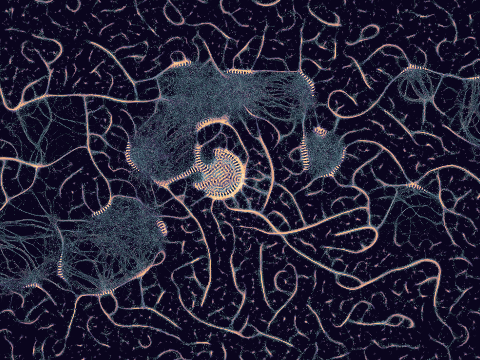
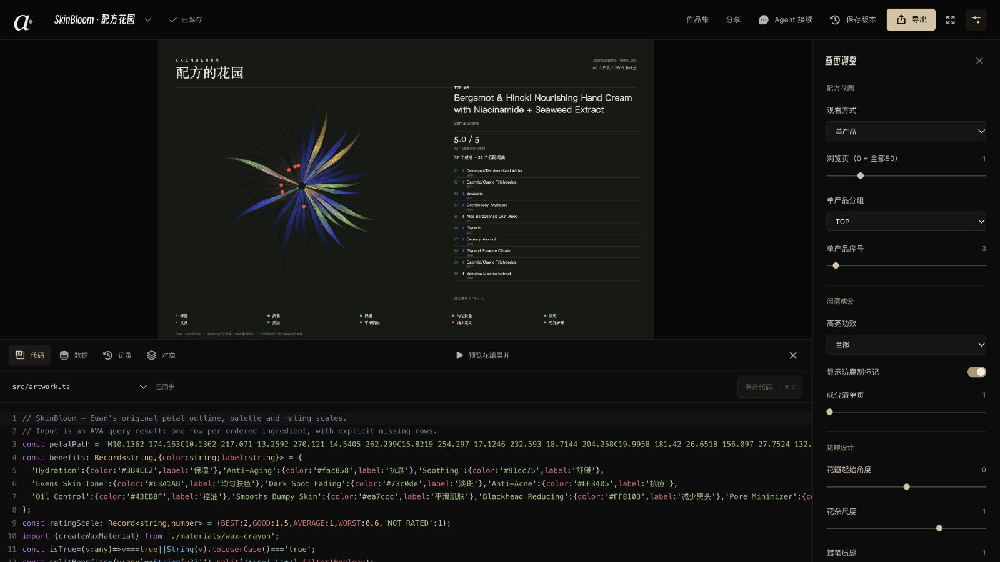

<p align="center">
  
</p>

<h1 align="center">VisBloom</h1>

<p align="center"><strong>Digital art and data visualization with your own coding agent.</strong></p>

<p align="center">
  <strong><a href="#make-your-first-work">Get started</a></strong> ·
  <a href="https://artwork.euantop.work/collection.html">Gallery</a> ·
  <a href="README.zh-CN.md">简体中文</a>
</p>

<table>
  <tr>
    <td width="50%" valign="top">
      <a href="https://artwork.euantop.work/artworks/physarum.html"></a><br>
      <strong>Physarum</strong><br>
      Watch a particle network grow from slime mold scans.
    </td>
    <td width="50%" valign="top">
      <a href="https://euantop.github.io/artwork-martover/"></a><br>
      <strong>Martover</strong><br>
      Rotate Mars and open a crater in the atlas.
    </td>
  </tr>
</table>

## Make your first work

**1. Start in your agent.** Open the [setup guide](https://artwork.euantop.work/help/agent-setup.html?lang=en) and copy its prompt into a coding agent with access to your computer. Give it an idea, an image, or a local dataset. To try the built-in example, ask it to open Physarum and make the branching finer.

**2. Refine it in the workbench.** Open the local preview your agent gives you. Try a parameter, edit the source, or give the agent another round of feedback. The preview, parameters, source, and versions belong to the same project.

<a href="apps/workbench/public/portal/platform-skinbloom-code.jpg"></a>

**3. Share the finished piece.** Export a PNG or a standalone interactive HTML file. The HTML runs on its own and can be hosted on GitHub Pages.

The Creator Kit supports macOS and Linux with Node.js 22.13+. The workbench interface is currently in Simplified Chinese.

## What’s inside

| Component | What it does |
| --- | --- |
| [Creative Skills](skills/entries.json) | Develop a concept, compare drafts, and look up techniques or public gallery references during a revision. |
| Local workbench | Preview and edit Canvas 2D, Three.js, and document artworks. Keep project files and versions on your own machine. |
| [AntV AVA](https://github.com/antvis/AVA) | Inspect CSV or JSON, query with read-only SQL, and use the result to drive the work. |
| [CLI](docs/CLI.md) and [MCP adapter](skills/core/data-art/references/mcp.md) | Let your agent read and update the same workbench project. The default setup uses the CLI. |

## Run from source

```sh
git clone https://github.com/EuanTop/VisBloom.git
cd VisBloom
npm ci
npm run dev
```

Open [127.0.0.1:4318](http://127.0.0.1:4318). Projects are saved in `.art-workbench/` by default. Use `ART_WORKBENCH_DIR` to change that location.

<details>
  <summary>Development and deployment</summary>

  Run `npm run check`, `npm test`, and `npm run build` before submitting changes. Include a screenshot or a short recording for changes to artwork or the interface.

  `npm run build:portal` produces the static website, gallery index, and downloads in `dist/portal/`. See the [deployment guide](docs/DEPLOYMENT.md).
</details>

## License and credits

Original VisBloom code and Skills are shared under [CC BY-NC 4.0](LICENSE). Third-party code, adapted Skills, artwork, fonts, and data retain their own terms. See the [artwork and library credits](https://artwork.euantop.work/portal/credits.html) and [Skill attribution catalog](skills/catalog.json).
