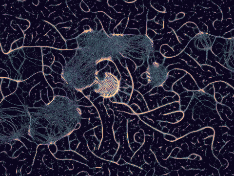
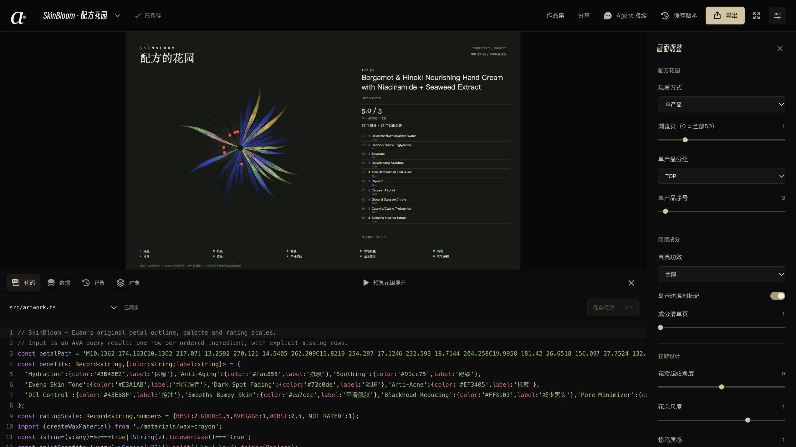

<p align="center">
  
</p>

<h1 align="center">VisBloom</h1>

<p align="center"><strong>用自己的编程 Agent 创作数字艺术与数据可视化作品。</strong></p>

<p align="center">
  <strong><a href="#做第一件作品">开始创作</a></strong> ·
  <a href="https://visbloom.euantop.work/collection.html">作品集</a> ·
  <a href="README.md">English</a>
</p>

<table>
  <tr>
    <td width="50%" valign="top">
      <a href="https://visbloom.euantop.work/artworks/physarum.html"></a><br>
      <strong>生长之间</strong><br>
      看黏菌扫描里的亮度和变化如何驱动粒子生长。
    </td>
    <td width="50%" valign="top">
      <a href="https://euantop.github.io/artwork-martover/"></a><br>
      <strong>Martover</strong><br>
      转动火星，在图谱里打开一座陨石坑。
    </td>
  </tr>
</table>

## 做第一件作品

**1. 在 Agent 里构思。** 把[接入指南](https://visbloom.euantop.work/help/agent-setup.html?lang=zh)的提示词发给能在本机执行命令的编程 Agent。可以从一个念头、一张图或一份本地数据开始。想试一试内置作品，就让它打开《生长之间》，把分枝调得更细一些。

**2. 在工作台改稿。** 打开 Agent 给你的本地预览。可以拖参数、直接改源码，也可以回到对话里把修改交给 Agent。画面、参数、源码和版本都保存在同一个项目里。

<a href="apps/workbench/public/portal/platform-skinbloom-code.jpg"></a>

**3. 分享成品。** 导出 PNG 或独立交互 HTML。HTML 可直接在浏览器打开，也可以部署到自己的 GitHub Pages。

Creator Kit 支持 macOS 和 Linux，要求 Node.js 22.13 或以上版本。工作台目前提供简体中文界面。

## 平台能力

| 组件 | 用途 |
| --- | --- |
| [创作 Skills](skills/entries.json) | 从灵感发展构思、比较草案，改稿时按需查专项技巧与公开社区作品。 |
| 本地工作台 | 预览和编辑 Canvas 2D、Three.js 和文档作品，工程文件和版本留在自己的机器。 |
| [AntV AVA](https://github.com/antvis/AVA) | 查看 CSV 或 JSON，通过只读 SQL 查询数据，用结果驱动作品。 |
| [CLI](docs/CLI.md) 与 [MCP 接入](skills/core/data-art/references/mcp.md) | 让 Agent 读写同一个工作台工程。默认接入走 CLI。 |

## 从源码运行

```sh
git clone https://github.com/EuanTop/VisBloom.git
cd VisBloom
npm ci
npm run dev
```

打开 [127.0.0.1:4318](http://127.0.0.1:4318)。工程默认保存在 `.art-workbench/`，可用 `ART_WORKBENCH_DIR` 指定目录。

<details>
  <summary>开发和部署</summary>

  提交改动前，请运行 `npm run check`、`npm test` 和 `npm run build`。作品和界面改动请附截图或短录屏。

  `npm run build:portal` 会把静态官网、作品索引和下载包构建到 `dist/portal/`。详见[部署文档](docs/DEPLOYMENT.md)。
</details>

## 许可与致谢

VisBloom 的原创代码和原创 Skills 采用 [CC BY-NC 4.0（署名–非商业性使用）](LICENSE)。第三方代码、改编 Skills、作品、字体和数据沿用各自许可。见[作品及依赖致谢](https://visbloom.euantop.work/portal/credits.html)和 [Skill 来源目录](skills/catalog.json)。
