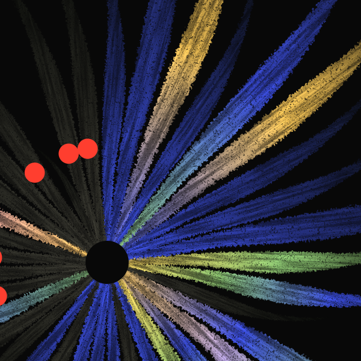

# What the calibration established

In the2026-11-10 SkinBloom iteration, the creator rejected (1) a uniform grain/noise treatment with a crisp vector silhouette, then (2) an entirely blurred petal treatment. The accepted direction retained clear pigment detail, paper-tooth interruptions, directionally correlated rubbing/overlap and an irregular dry edge.

This is a600×600 unscaled crop from a real3200×2200 workbench export. It is a visual calibration example, not a template to reproduce or a universal scale/palette. The red preservative dots deliberately remain clear; this example does not authorize hard dots in every composition. The creator approved this work, while transfer to new subjects and the effect of loading this Skill still require actual use.

When the request says "soft edge", distinguish a fragmented, grain-bearing boundary from optical defocus. When it says "fine grain", look for variation at several scales and actual stroke structure; increasing random noise frequency or bitmap size alone does not satisfy it. Paper/background color and distance strongly change perceived quality, so evaluate in the intended scene.

Source: project-authored SkinBloom material and the creator's explicit feedback. No external artwork, preset or third-party texture was copied. Input data and original geometry belong to the case, not this Skill. Canvas helper and calibration asset are included so a portable Skill bundle does not depend on developer-machine paths. The detailed development/capture record remains in the project's docs/evidence/skinbloom-wax-grain-2026-11-10.
